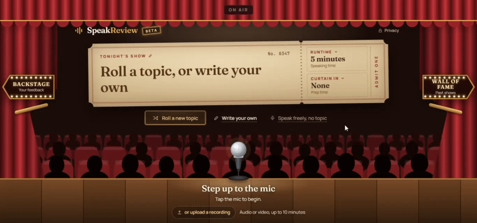
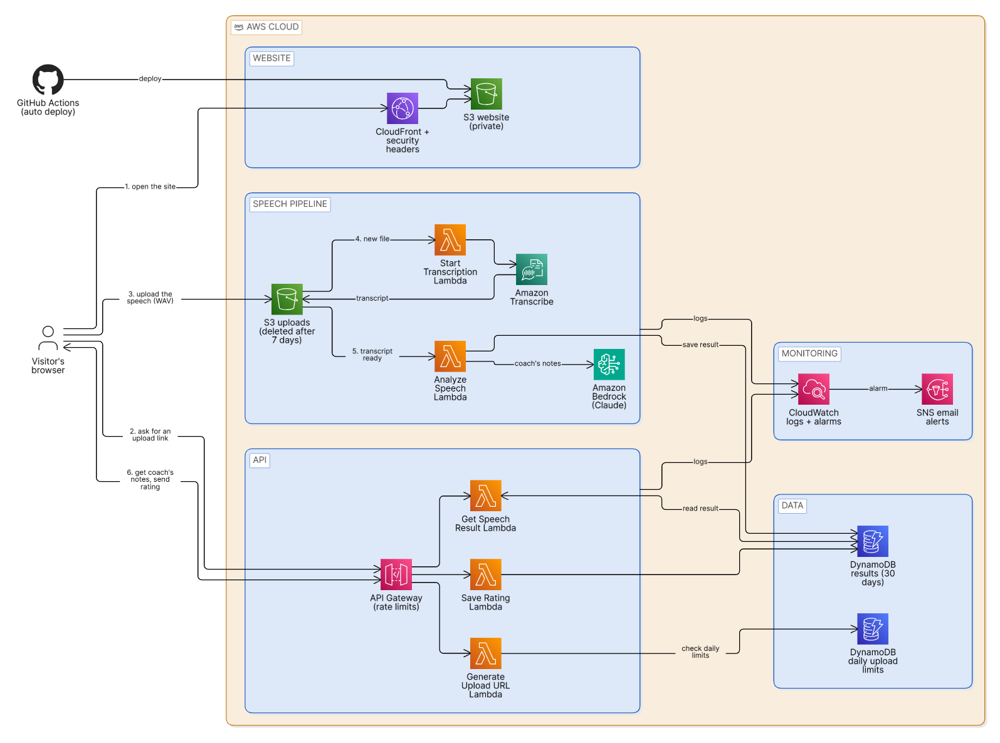
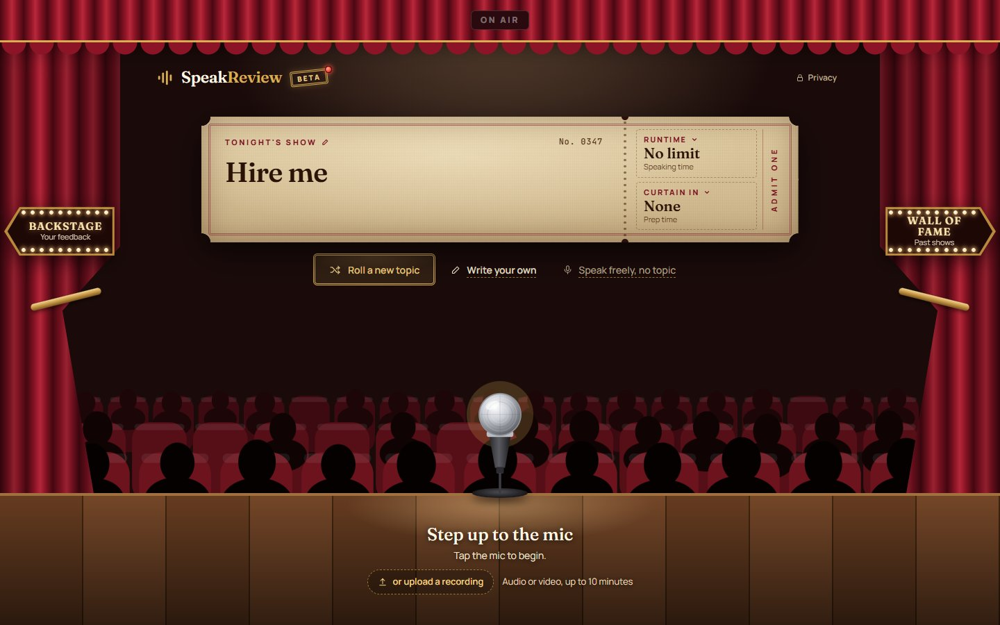
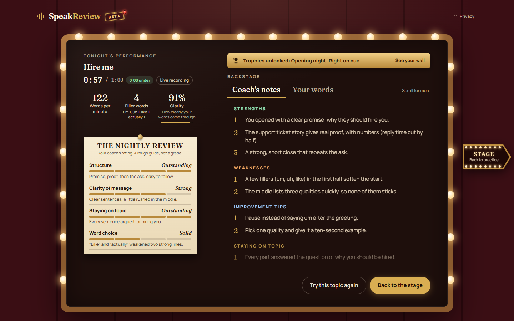
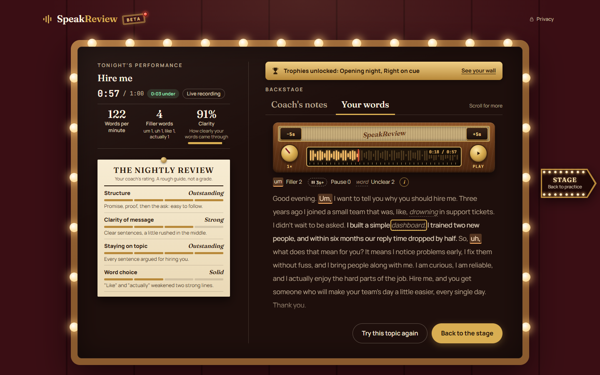
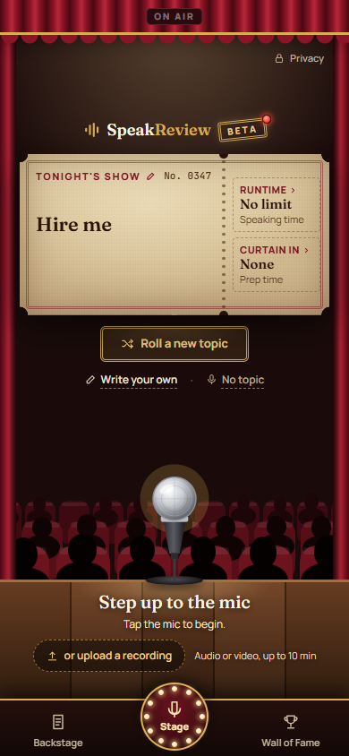
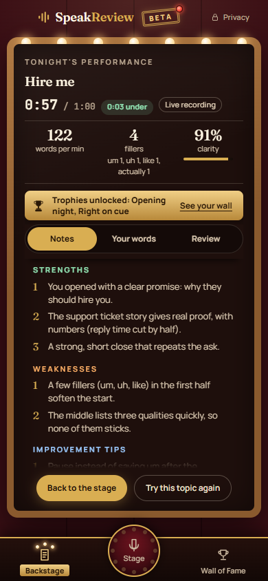

# SpeakReview

[](https://github.com/jayveedelarosa/speakreview/actions/workflows/deploy.yml)

Practice your speech with an AI coach.



SpeakReview is a public speaking practice site. Pick or write a topic, record yourself or upload a recording, and an AI coach sends back notes, speaking stats and a word-by-word replay of what you said. It is free while in beta.

Live site: https://speakreview.jayveedelarosa.dev/

## Features

- Roll a random topic, write your own (up to 120 characters), or speak freely with no topic.
- Set a speaking time from 30 seconds to 10 minutes (or no limit), prep time and a stage name in Tonight's programme.
- Record in the browser, or upload audio or video. Uploaded files are converted on the device, so only the sound is sent.
- Watch Intermission's three acts while the speech is sent, written down and reviewed.
- Read the coach's notes (strengths, weaknesses, tips, staying on topic, time management) next to words per minute, filler words and clarity.
- Get The Nightly Review: four short ratings on structure, clarity, staying on topic and word choice.
- Open "Your words": the full transcript with filler words, pauses and unclear words marked, and a replay radio with speeds from 0.5x to 2x and 5-second skips that lights up each word as it plays.
- Keep a history in Backstage and on the Wall of Fame, and earn trophies, all stored on your own device.
- Answer "How was the coach tonight?" to rate the feedback.
- Use it on a laptop or a phone.

## How it works



1. **Open the site.** CloudFront serves the page from a private S3 bucket and adds the security headers.
2. **Ask for an upload link.** The page calls the API, which checks the daily limits and returns a short-lived upload link.
3. **Upload the speech.** The browser sends the sound (a WAV file) straight to the uploads bucket.
4. **Transcription starts.** The new file starts an Amazon Transcribe job, which writes down every word with its timing.
5. **The coach writes notes.** When the transcript is ready, Amazon Bedrock (Claude) writes the coach's notes, and the result is saved.
6. **The page gets the notes, and the visitor rates them.** The page checks for the result until it's ready, shows it, and can send back the visitor's rating.

The five Lambda functions:

- **GenerateUploadURL**: checks the daily upload limits and returns a short-lived upload link.
- **StartTranscription**: starts Amazon Transcribe when a new speech arrives.
- **AnalyzeSpeech**: sends the transcript to Amazon Bedrock for the coach's notes, and saves the result.
- **GetSpeechResult**: returns the result to the page once it's ready.
- **SaveRating**: stores the visitor's "How was the coach tonight?" answer.

The Lambda code is kept private and is not in this repository.

## Screenshots

| | |
|---|---|
|  |  |
| The Stage: the topic on a ticket, the mic and the upload button | Intermission: Act II is writing down every word |
|  |  |
| Coach's notes, the stats and The Nightly Review | Your words: the replay radio follows the transcript |
|  |  |
| The Stage on a phone | The results on a phone |

## Security and cost

- The website bucket is private and only served through CloudFront.
- Strict security headers: a content security policy with no inline scripts, no inline styles and no eval, plus a permissions policy.
- Rate limits on the API.
- A daily upload limit for each visitor and an overall daily limit.
- Short-lived upload links.
- Input checks on the page (for example, recordings up to 10 minutes and topics up to 120 characters), with the limits enforced again on the server.
- Speech audio is deleted automatically after 7 days, and results after 30 days.
- CloudWatch alarms send email alerts.
- Deploys log in to AWS with a short-lived role from GitHub Actions, so no access keys are stored.
- Every service is pay-per-use, so the cost stays near zero when nobody is using it.

## Built with

- **Front end:** plain HTML, CSS and JavaScript, with no frameworks or build step. Fonts from Google Fonts.
- **AWS:** S3, CloudFront, API Gateway, Lambda, Amazon Transcribe, Amazon Bedrock (Claude), DynamoDB, CloudWatch and SNS.
- **Deploys:** GitHub Actions, whenever the site's files change.
- **Tests:** Node.js driving headless Google Chrome through the DevTools protocol, with a fake API so the tests never touch AWS.

## Privacy and limits

What leaves your device, and is deleted automatically:

- The sound of your speech, used only to create your feedback. Deleted after 7 days.
- Your results, including your "How was the coach tonight?" answer. Deleted after 30 days. A count of the answers is kept.
- A random code made by your browser, used only to count how many people come back. It isn't linked to your name.

What stays on your device:

- Your Wall of Fame, trophies and the words of your latest 30 performances.
- Your stage name, which is never sent anywhere.

The feedback form is run by Google Forms, separately from SpeakReview, and asks for no name or email. Clearing the site's data removes everything stored on the device and resets the code. The full privacy note is on the site, under the "Privacy" button.

## Known limitations

- It's in beta, so things may change.
- Your history lives only in the browser you used, and is lost if you clear the site's data.
- There are daily upload limits.
- Speeches can be up to 10 minutes long, and recordings must be at least 15 seconds. Files picked for upload can be up to 200 MB on a laptop and 100 MB on a phone.
- The replay only works for the speech you just gave. Recordings are never saved, so past shows can be read but not played.
- The transcript and the AI feedback can be wrong.

## What I learned

- I started building with ChatGPT and Gemini, then moved to Claude. Along the way I learned to steer AI tools with clear plans, reviews and tests instead of just accepting what they gave me.
- Building with AWS serverless pieces (S3, CloudFront, API Gateway, Lambda, Transcribe, DynamoDB) taught me how separate services can hand work to each other without a server running all day.
- Moving the coaching from OpenAI to Amazon Bedrock taught me to keep the AI part swappable, and to keep every call inside my own cloud account.
- AI output is messy. A single quote mark once broke the coach's notes on long speeches, so I learned to check, clean and rescue the AI's answer before showing it.
- Keeping costs safe for a public app meant rate limits, daily upload limits, data that deletes itself and alarms, all set up before launch, not after.
- A strict content security policy forced me to keep every script and style in proper files, which made the whole site cleaner.
- Automated browser tests caught real bugs, but long test runs and the odd flaky screenshot test taught me to run only the tests that matter for each change.
- Designing for phones meant testing on a real phone, because the mockups hid how crowded the screen really gets.

## Running the tests

The tests open the site in headless Google Chrome with the same security headers as production. Every API and S3 request is answered by a fake, so no AWS account or keys are needed.

You need Node.js 22 or newer, Google Chrome and Git. Then, once:

```
cd tests
npm install
```

Run every suite (this takes about an hour):

```
npm test
```

Run only the suites you name:

```
npm run test:only -- csp playback
```

The list of suites and what each one checks is in [tests/README.md](tests/README.md).

## Feedback

Tried it? Tell me what you think in the [beta feedback form](https://forms.gle/pDd4x4mFGkh8L27L6).

## Author

Jayvee Dela Rosa. Portfolio: https://jayveedelarosa.dev, LinkedIn: https://www.linkedin.com/in/jayveedelarosa/

## Licence

All rights reserved. See [LICENSE](LICENSE).
